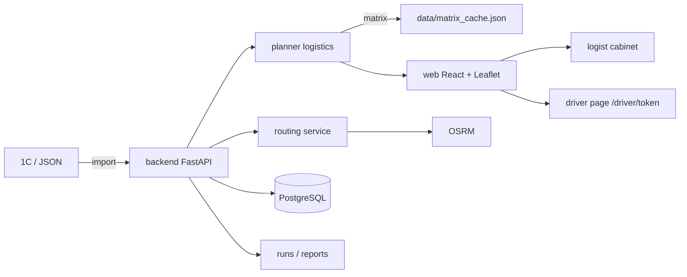

# MilkLogistic — планирование доставки «Молочного Мира»

**Оптимизация развоза 214 заявок по Гродно:** реальные дорожные расстояния, 16 машин,
маршруты на карте, выдача водителям, отметки доставки и доп. заезды.

[](docker-compose.yml)
[](.github/workflows/desktop.yml)
[](https://artemiysd.github.io/MilkLogistic/)
[](tests)
[](#)
[](#)

**Ссылки:** [Онлайн-демо](https://artemiysd.github.io/MilkLogistic/) ·
[Релизы и установщики](https://github.com/Artemiysd/MilkLogistic/releases) ·
[Подробный гайд](README-GUIDE.md)

> Онлайн-демо на GitHub Pages показывает интерфейс и демо-данные: расчёты выполняет
> бэкенд, поэтому локальный запуск (ниже) — основной способ. Для полностью рабочего
> демо в интернете нужен публичный адрес API (`API_BASE_URL`).

## Что умеет

- загружает заявки, парк и ограничения из JSON (`data/logistics_data.json`);
- принимает выгрузки 1С (`POST /api/import`, `/api/import/file`): проверка контракта,
  отдельная матрица по координатам, выбор активного набора;
- выдаёт маршруты водителям: база водителей, персональные ссылки `/driver/<token>`,
  отметки «доставлено / не доставлено», журнал проблем и пересчёт остатка;
- планирует доп. заезд: остаток первой волны (и/или свежая выгрузка 1С) на машинах,
  которые вернулись раньше остальных;
- считает дорожные расстояния и время по OSRM (матрица 215×215, `data/matrix_cache.json`);
- распределяет адреса по машинам с учётом грузоподъёмности, минимальной загрузки 90%,
  ограничения улиц (Советская / Мостовая / Замковая — только 1,5 т), окон доставки и смены;
- строит порядок объезда, расписание с прибытием/выездом и километражем;
- рисует маршруты на карте, считает экономию и показывает отчёт;
- умеет работать частично: если машин не хватает, честно показывает «не развезено» и вес.

Текущий результат на реальных данных: **658.3 км → 631.5 км (−4.1%)**, 16 машин,
развезено 59 940 кг из 63 630 кг; 31 адрес (3 690 кг) физически не влезает
в 8-часовые смены. Три рейса получаются с загрузкой ниже 90% — они не уходят
водителям автоматически: логист решает «отправить / пересчитать / не отправлять».

## Архитектура



| Компонент | Что делает | Порт |
|---|---|---|
| `src/` | React + Leaflet: планирование, кабинет, страница водителя | 8080 |
| `backend/` | API, импорт 1С, база водителей, отчёты | 8000 |
| `logistics/` | планировщик: распределение, порядок, расписание | — |
| `services/routing/` | координаты → OSRM → км/минуты/геометрия | 8100 |
| OSRM | локальная маршрутизация по карте Гродно (опционально) | 5000 |
| `db` | PostgreSQL (задел под 1С и историю) | 5432 |

## Структура проекта

```text
MilkLogistic/
├── .github/workflows/      CI: GitHub Pages и сборки Windows/macOS
├── backend/app/            FastAPI: API, импорт 1С, водители, отчёты
├── logistics/              алгоритм: распределение, маршрут, расписание
├── services/routing/       сервис OSRM
├── src/                    React + TypeScript + Leaflet
│   ├── pages/              главная, кабинет логиста, страница водителя
│   └── components/         карта, карточки, обработка ошибок
├── data/                   заявки, матрица, импортированные наборы, прогоны
├── infra/                  nginx, mock-api, сборка матрицы, OSRM
├── electron/               десктоп-обёртка (Windows/macOS)
├── tests/                  тесты планировщика, импорта, водителей
├── public/examples/        примеры выгрузок 1С
├── schema.json             контракт данных 1С ↔ бэкенд ↔ фронтенд
├── docker-compose.yml      стек: web + api + routing + db (+ osrm)
└── README-GUIDE.md         подробный гайд по кнопкам и пересчётам
```

## Быстрый старт

Нужен **Docker Desktop** (Windows, macOS) или Docker + Compose (Linux).

```bash
git clone https://github.com/Artemiysd/MilkLogistic.git
cd MilkLogistic
cp .env.example .env
docker compose -f docker-compose.yml -f docker-compose.backend.yml up -d --build
```

macOS/Linux: `chmod +x *.sh && ./start.sh` — делает то же и открывает браузер.
Windows: `start.bat`.

Открыть **http://localhost:8080** и нажать «Построить маршруты».

> Apple Silicon: образ OSRM только amd64, в compose стоит `platform: linux/amd64`.
> В Docker Desktop должно быть включено «Use Rosetta for x86_64/amd64 emulation».
> Без локального графа OSRM используется публичный сервер — Rosetta не нужна.

> Apple Silicon: образ OSRM только amd64, в compose стоит `platform: linux/amd64`.
> В Docker Desktop должно быть включено «Use Rosetta for x86_64/amd64 emulation».

### Без Docker (для разработки)

```bash
# бэкенд
cd backend
pip install -r requirements.txt
uvicorn app.main:app --reload --port 8000

# фронтенд (в другом терминале)
npm install
npm run dev          # http://localhost:5173, /api проксируется на :8000
```

Свой OSRM не обязателен для разработки: в `.env.example` по умолчанию публичный
`https://router.project-osrm.org`. Для офлайн-демо — `infra/osrm/prepare.ps1`.

## Структура

```
backend/app/          FastAPI: main.py (эндпоинты), planner_adapter.py (матрица + маппинг),
                      datasets.py (импорт выгрузок 1С), report.py (HTML-отчёт с картой)
logistics/            планировщик Даника: planner, routing, data_loader, models, export
services/routing/     сервис маршрутизации: OSRM-клиент, кэш, нарезка на блоки
src/                  React + TypeScript + Leaflet
data/                 данные задачи, ручные правки координат, матрица расстояний
data/imports/         импортированные выгрузки 1С (набор, карточка, матрица)
infra/                nginx, mock-api, сборка матрицы, подготовка OSRM, preflight
schema.json           контракт данных (1С ↔ бэкенд ↔ фронтенд)
```

## API

| Метод | Путь | Назначение |
|---|---|---|
| GET | `/api/health` | состояние, точки, машины, матрица, активный набор |
| GET | `/api/data` | склад, машины, точки, ограничения (`?dataset_id=`) |
| POST | `/api/optimize` | расчёт плана (`{"drivers": 16, "dataset_id": null}`) |
| GET | `/api/runs` | последние прогоны |
| GET | `/api/runs/{id}` | полный JSON прогона |
| GET | `/api/runs/{id}/report` | HTML-отчёт: карта, маршруты, расшифровка |
| GET | `/api/runs/{id}/geojson` | линии маршрутов для ГИС |
| POST | `/api/import` | импорт выгрузки 1С телом запроса |
| POST | `/api/import/file` | импорт одной или нескольких выгрузок файлом |
| GET | `/api/datasets` | список импортированных наборов |
| GET | `/api/datasets/{id}` | карточка набора + состояние матрицы |
| GET | `/api/datasets/{id}/data` | данные набора |
| POST | `/api/datasets/active` | выбрать активный набор (`{"dataset_id": null}` — штатные данные) |
| DELETE | `/api/datasets/{id}` | удалить набор |
| POST | `/api/runs/{id}/dispatch` | раздать рейсы водителям, получить ссылки |
| POST | `/api/runs/{id}/rebalance` | пересчитать без недогруза (жёстко 90%) |
| POST | `/api/runs/{id}/extra` | доп. заезд: остаток + новая выгрузка 1С |
| GET | `/api/dispatch` | сводка: водители, маршруты, прогресс |
| GET/POST/PATCH/DELETE | `/api/drivers` | база водителей |
| POST | `/api/drivers/seed` | создать водителей по парку |
| GET | `/api/driver/{token}` | маршрут водителя по персональной ссылке |
| POST | `/api/driver/{token}/stops/{seq}` | доставлено / не доставлено |
| POST | `/api/driver/{token}/problem` | сообщить логисту о проблеме |
| POST | `/api/assignments/{id}/replan` | пересчитать остаток маршрута с текущего времени |
| POST | `/api/assignments/{id}/cancel` | отменить выданный маршрут |

Сервис маршрутизации: `POST /api/calculate-route`, `POST /api/calculate-table` —
см. [`services/routing/README.md`](services/routing/README.md).

Swagger: http://localhost:8000/docs

## Импорт выгрузок 1С

Готовые примеры для проверки лежат в `public/examples/` и доступны по ссылкам
`/examples/1c-example-day.json` (9 точек, 1 машина 5 т, загрузка ~91%) и
`/examples/1c-example-small.json` (4 точки, 2 машины).

Формат — [`schema.json`](schema.json). Импорт проверяет контракт, сохраняет набор
в `data/imports/`, собирает по координатам дорожную матрицу через сервис
маршрутизации и делает набор активным: фронтенд и `/api/optimize` сразу работают
с новыми заявками, перезапуск не нужен.

```bash
# файлом (можно несколько за раз)
curl -X POST "http://localhost:8000/api/import/file?activate=true" \
     -F "files=@vypiska-1c.json"

# телом запроса
curl -X POST "http://localhost:8000/api/import?name=Понедельник" \
     -H "Content-Type: application/json" \
     --data-binary @vypiska-1c.json

# вернуться к штатным данным logistics_data.json
curl -X POST http://localhost:8000/api/datasets/active \
     -H "Content-Type: application/json" -d '{"dataset_id": null}'
```

Особенности:

- если в выгрузке есть `meta.document_number`, имя набора берётся из него;
- матрица строится по адресам с координатами; адреса без координат попадают
  в `matrix.skipped_addresses`, для них действует запасная оценка и предупреждение;
- больше 300 адресов с координатами за раз сервис маршрутизации не считает —
  импорт сохранит набор, но матрицу придётся собрать частями;
- ошибки контракта возвращаются с кодом 422 и текстом, что именно не так.

## Водители и доп. заезд

1. На главной странице: «Оптимизировать маршрут» → «Отправить водителям».
   Если водителей ещё нет, они создаются по числу рейсов и закрепляются за машинами.
2. Логист попадает в `/dispatch`: там база водителей, персональные ссылки, прогресс.
3. Водитель открывает `/driver/<token>` на телефоне: карта только с его точками,
   кнопки «Доставлено» / «Не доставлено» (с причиной), «Сообщить о проблеме».
   После отметки точка исчезает с карты, у логиста растёт прогресс.
4. Если водитель не успевает — логист нажимает «Пересчитать остаток»: система
   строит новый порядок невыполненных точек с текущего времени и честно проверяет смену.
5. Если после первой волны остались адреса — на главной появляется «Доп. заезд (остаток)».
   При необходимости приложите новую выгрузку 1С: её заявки добавятся к остатку.
   Доп. заезд садится на машины, вернувшиеся раньше остальных.


## Скрипты (Windows)

| Файл | Что делает |
|---|---|
| `start.bat` / `stop.bat` | поднять / остановить стек |
| `check.bat` | 12 проверок окружения |
| `verify-osrm.bat` | сверка маршрута с матрицей на всех точках |
| `plan.bat` | открыть страницу проверки расчётов |

Linux/macOS: те же команды, но через `docker compose` напрямую.

## Ограничения модели

- разгрузка считается **30 минут на физический адрес** (192 адреса из 214 заявок);
- смена 08:00–17:00, обед 13:00–14:00, работа ≤ 8 ч;
- машина делает один рейс, водитель может взять несколько машин за смену, если успевает;
- точка на Советской / Мостовой / Замковой обслуживается только машиной 1,5 т;
- расстояние между одинаковыми координатами = 0, но разгрузка на каждую организацию своя.

## Сборки и версии

| Что | Где взять |
|---|---|
| **Онлайн-демо** | https://artemiysd.github.io/MilkLogistic/ |
| **Windows** | [Releases](https://github.com/Artemiysd/MilkLogistic/releases): `MilkLogistic Setup *.exe` и portable |
| **macOS** | Releases: `.dmg` и `.zip` для **arm64** и **x64** |
| **Исходники** | ветка `main` (стабильно) и `develop` (рабочая), тег `v1.0.3` |
| **Артефакты CI** | Actions → *Build desktop apps* |

Релиз создаётся автоматически при пуше тега `v*`: workflow собирает Windows и macOS
и прикладывает установщики к GitHub Release.

## Десктоп (Electron)

Приложение собирается как обычное Windows-приложение: Electron раздаёт фронтенд из `dist/`
и подключается к бэкенду (по умолчанию `http://localhost:8080`).

```bash
npm install
npm run electron:start   # запуск в окне (нужен поднятый стек: start.bat)
npm run electron:dir     # распакованная сборка: release/win-unpacked
npm run electron:build   # установщик и portable: release/
```

Готовые файлы после сборки:

- `release/MilkLogistic Setup 1.0.0.exe` — установщик;
- `release/MilkLogistic 1.0.0.exe` — portable, без установки;
- `release/win-unpacked/MilkLogistic.exe` — распакованная версия.

Перед расчётами должен быть запущен бэкенд (`start.bat`, Docker). Адрес API меняется
переменной `MILK_API_BASE` или файлом `milk-config.json` рядом с exe / в профиле:

```json
{ "apiBase": "http://localhost:8080" }
```

### macOS

```bash
cd MilkLogistic
npm install
npm run electron:build:mac   # release/*.dmg и *.zip (x64 + arm64)
```

Сборка не подписана (сертификата Apple нет). Первый запуск: правый клик по
`MilkLogistic.app` → **Открыть**, либо снять карантин:

```bash
xattr -dr com.apple.quarantine /Applications/MilkLogistic.app
```

Стек на Mac:

```bash
./start.sh
```

Для Apple Silicon Docker запускает OSRM через Rosetta (`platform: linux/amd64`
в compose) — в Docker Desktop должно быть включено **Use Rosetta for x86_64/amd64 emulation**.

Готовые сборки обеих платформ можно получить и без локального Mac:
GitHub → **Actions → Build desktop apps → Run workflow** → скачать артефакт
`MilkLogistic-macos` (или `MilkLogistic-windows`) из завершённого запуска.

## GitHub Pages

Веб-версия публикуется автоматически: [`.github/workflows/pages.yml`](.github/workflows/pages.yml)
собирает фронтенд с базой `/MilkLogistic/` и кладёт в ветку `gh-pages`.

- адрес: **https://artemiysd.github.io/MilkLogistic/**
- включить: Settings → Pages → Build and deployment → Deploy from a branch → `gh-pages` / root;
- для рабочих расчётов задайте переменную репозитория `API_BASE_URL`
  (Settings → Secrets and variables → Actions → Variables) с публичным HTTPS-адресом бэкенда.
  Без неё сайт открывает интерфейс, но запросы к API не работают.

## Документация

- [`README-GUIDE.md`](README-GUIDE.md) — подробный гайд: каждая кнопка, пересчёты, ссылки
- [`README-INFRA.md`](README-INFRA.md) — Docker, сервисы, матрица, проверки, демо без интернета
- [`README-ALGORITHM.md`](README-ALGORITHM.md) — правила планировщика и его CLI
- [`schema.json`](schema.json) — контракт входных данных

## Ветки

`main` — готовая сборка (фронтенд + бэкенд + инфраструктура).
`frontend`, `algorithm` — история разработки отдельных частей.

